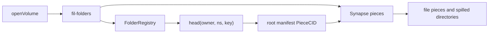

# Filecoin Folders

A library for folder volumes on Filecoin, plus FiFolders, a static file manager in `apps/fifolders`.

The library stores an immutable JSON manifest as a [Synapse](https://docs.filecoin.cloud/) piece. A small FEVM contract, `FolderRegistry`, points at the current root with compare-and-swap.



## Layout

| Path | Role |
| --- | --- |
| `contracts/` | Foundry project. `FolderRegistry` plus Calibration and mainnet deploy scripts. |
| `packages/fil-folders` | TypeScript ESM package. Browser and Node.js 22+. |
| `examples/cli.ts` | `ls` / `put` / `get` against Calibration. |
| `apps/fifolders` | FiFolders, a static Vite file manager on `fil-folders`. FiPen documents and FiGrid spreadsheets are at `/fipen/` and `/figrid/`. |

## Registry

`FolderRegistry` is not upgradeable. One head is stored per `(owner, ns, key)`.

```solidity
commit(bytes32 ns, bytes32 key, bytes pieceCid, bytes prevPieceCid)
commitFor(address owner, bytes32 ns, bytes32 key, bytes pieceCid, bytes prevPieceCid)
setWriter(bytes32 ns, address writer, bool allowed)
head(address owner, bytes32 ns, bytes32 key) returns (bytes pieceCid, uint64 version)
```

`commit` writes the caller's head. `commitFor` writes the volume owner's head when the caller is that owner, a writer approved for `ns`, or a session key whose Filecoin `SessionKeyRegistry` authorization for `PERMISSION_COMMIT` (`keccak256("fil-folders.commit")`) is still at or after `block.timestamp`. The head stays under the volume owner. `setWriter(ns, writer, false)` revokes the writer. The owner stays authorized. Session keys are not writers.

The contract admin (`owner`) is separate from volume owners. The constructor takes that admin and the chain's `SessionKeyRegistry`. The admin can replace the registry with `setSessionKeyRegistry`. Mappings for heads and writers stay in slots 0 and 1.

The head starts empty, version `0`. A commit stores `pieceCid` only when `prevPieceCid` matches the current bytes. Otherwise it reverts with `CasConflict(currentPieceCid, currentVersion)` and leaves the head unchanged. Success increments `version` and emits

```solidity
Committed(owner, ns, key, pieceCid, prevPieceCid, version, timestamp)
```

Piece CID payloads are capped at 128 bytes. `fil-folders` stores the UTF-8 PieceCID string. The namespace and volume key are hashes, so names are not limited to 32 bytes:

- `ns = keccak256(utf8("fil-folders"))`
- `key = keccak256(utf8(volumeName))`

Bytecode targets Shanghai (Paris opcodes plus `PUSH0`), which is the FEVM opcode set. Tests run in Foundry. Anvil exercises the viem adapter against the compiled artifact. Nothing in this repo deploys to a network.

### Deploy

Set `PRIVATE_KEY` in the environment. Do not pass it as a CLI flag. The scripts refuse any chain id other than the one they target, and they do not print the key.

```bash
# Calibration, chain id 314159
# RPC https://api.calibration.node.glif.io/rpc/v1
PRIVATE_KEY=0x... pnpm deploy:calibration

# Mainnet, chain id 314
# RPC https://api.node.glif.io/rpc/v1
PRIVATE_KEY=0x... pnpm deploy:mainnet
```

Constructor arguments are the deployer address (admin) and the SessionKeyRegistry:

| Network | SessionKeyRegistry |
| --- | --- |
| Calibration (314159) | `0x518411c2062E119Aaf7A8B12A2eDf9a939347655` |
| Mainnet (314) | `0x74FD50525A958aF5d484601E252271f9625231aB` |

The Calibration address in [deployments/calibration.json](deployments/calibration.json) is the previous contract. It has no session-key check. Deploy this build from your own machine (do not reuse that address) and point FiFolders at the new address with `VITE_FOLDER_REGISTRY` and `VITE_REGISTRY_FROM_BLOCK`.

The contract is unaudited.

## Folder model

A manifest is JSON:

```json
{
  "v": 1,
  "mtime": 1700000000000,
  "entries": [
    {
      "name": "notes.txt",
      "type": "file",
      "pieceCid": "bafkzcib...",
      "size": 12,
      "mime": "text/plain",
      "mtime": 1700000000000
    }
  ]
}
```

Each commit uploads one CARv1 piece. The root block is the volume manifest. New or changed file bytes are other blocks in that same CAR, and the registry head is the piece CID. A `located` map on the manifest records content CID to piece for bytes that still live in an older piece. Reads fetch that piece (a byte range when the store supports it, otherwise the whole piece), parse the CAR, and cache the blocks. A metadata-only commit is a manifest-only CAR, padded to at least 127 bytes. Heads that are still raw manifest JSON, with one piece per file, still open.

Directory entries are inlined until their canonical JSON exceeds `dirThreshold` (default 24 KiB). Past that, the directory manifest is another block in the same CAR. File `pieceCid` values are content CIDs. `size` is the plaintext byte length.

```ts
import { createSynapseStorage, createViemRegistry, openVolume } from "fil-folders";

const volume = await openVolume({
  synapse, // @filoz/synapse-sdk Synapse
  registry, // Registry implementation
  owner, // address
  name: "notes",
});

await volume.mkdir("/docs");
await volume.put("/docs/a.txt", bytes, { mime: "text/plain" });
await volume.get("/docs/a.txt");
await volume.ls("/docs");
await volume.stat("/docs/a.txt");
await volume.mv("/docs/a.txt", "/a.txt");
await volume.cp("/a.txt", "/b.txt");
await volume.rm("/docs", { recursive: true });
await volume.history(); // Committed events
await volume.history("/a.txt"); // versions where that path changed

await volume.tx(async (draft) => {
  await draft.put("/a.txt", one);
  await draft.put("/b.txt", two); // one registry commit
});
```

`put` accepts `Uint8Array` or a web `ReadableStream`. Outside `tx`, each call rebases on the latest head and commits. Inside `tx`, edits share one draft. Piece uploads happen as files are written; the registry transaction is the snapshot that publishes them.

### Conflicts

A commit sends the piece CID it read as `prevPieceCid`. If the head moved, the contract reverts `CasConflict`. The library refetches the head and three-way merges:

- base is the tree the writer started from
- ours is the local draft
- theirs is the new head

Directory identity ignores mtime. File identity is the content piece, size, mime, and content-encryption parameters. Edits to different paths both apply. The same resulting bytes on both sides apply. A delete next to a new child under that delete, or two different bytes at one path, throws `CasConflictError` with those paths. Non-overlapping merges retry, up to `maxRetries` (default 5).

Writers approved with `registry.setWriter` can move the head. Encryption does not stop a writer from publishing a new manifest. Treat writers as trusted for integrity of the pointer.

### Encryption

Pass `encryption` to `openVolume` to encrypt each file with AES-GCM and a fresh 12-byte IV. Entry names are encrypted the same way, so manifests do not contain plaintext names. Mime types stay visible.

The volume key is HKDF-SHA256 of an EIP-712 signature (or `personal_sign` when `mode` is `"personal_sign"`). The signature covers the owner, volume name, and purpose. HKDF info also includes the chain id, registry address, and mode, so those must match on every open. The key never leaves WebCrypto.

### Adapters

| Interface | Default | Mock |
| --- | --- | --- |
| `Storage` | `createSynapseStorage(synapse)` on `@filoz/synapse-sdk` `storage.upload` / `storage.download` | `createMemoryStorage()` (`mem:` plus SHA-256) |
| `Registry` | `createViemRegistry({ address, publicClient, walletClient })` | `createMemoryRegistry(signer)` |

`@filoz/synapse-sdk` is an optional peer. The Synapse SDK calls `Array.fromAsync` and `Promise.withResolvers`, which means Node.js 22+ or a current browser. `assertSupportedRuntime()` checks both. PieceCID hashing in the SDK needs `'wasm-unsafe-eval'` if the page sets `script-src`.

## Example CLI

Calibration only. The process reads `PRIVATE_KEY` from the environment and redacts 32-byte hex strings from errors.

```bash
pnpm build
PRIVATE_KEY=0x... REGISTRY=0x... pnpm example ls notes
PRIVATE_KEY=0x... REGISTRY=0x... pnpm example put notes /a.txt ./a.txt --mime text/plain
PRIVATE_KEY=0x... REGISTRY=0x... pnpm example get notes /a.txt ./out.txt
```

`RPC_URL` overrides the endpoint and still targets chain id 314159. The default RPC is `https://api.calibration.node.glif.io/rpc/v1`.

## Development

Foundry (`forge`, `anvil`) and Node.js 22+ are required.

```bash
pnpm install
pnpm test
```

`pnpm test` runs `forge test`, the fil-folders vitest suite (CRUD, mv/rm, history, conflict merge, encryption, and the anvil registry test), the package typecheck, the example typecheck, and the FiFolders unit tests. FiFolders browser tests are `pnpm --filter fifolders e2e`.

## License

MIT. `contracts/lib/forge-std` is vendored forge-std v1.9.6, also MIT.

## Deployments

| Network | Chain id | FolderRegistry | Deploy block |
| --- | --- | --- | --- |
| Filecoin Calibration | 314159 | `0x4893FfF3611240fbB4Be68eFe4AA0Ec634279331` | 4207373 |

Details in [`deployments/calibration.json`](deployments/calibration.json). Pass the deploy block as
`fromBlock` to `createViemRegistry` so `history()` does not scan from block 0 (Glif rejects that).

FEVM gas note: deploying costs ~54M gas units, far above what `forge script`'s simulation estimates,
so `forge script --broadcast` fails on chain. The deploy scripts use `forge create`, which takes the
node's `eth_estimateGas`. The Calibration deployment above was sent with `cast send --create`.
