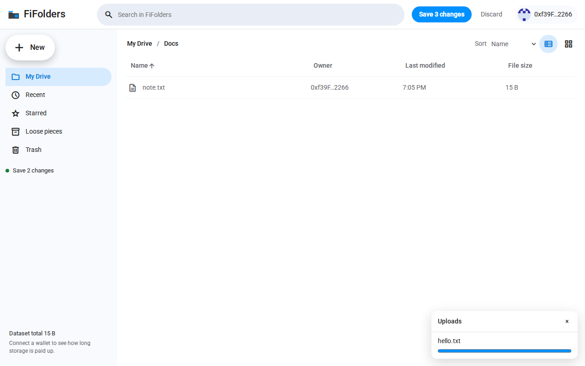
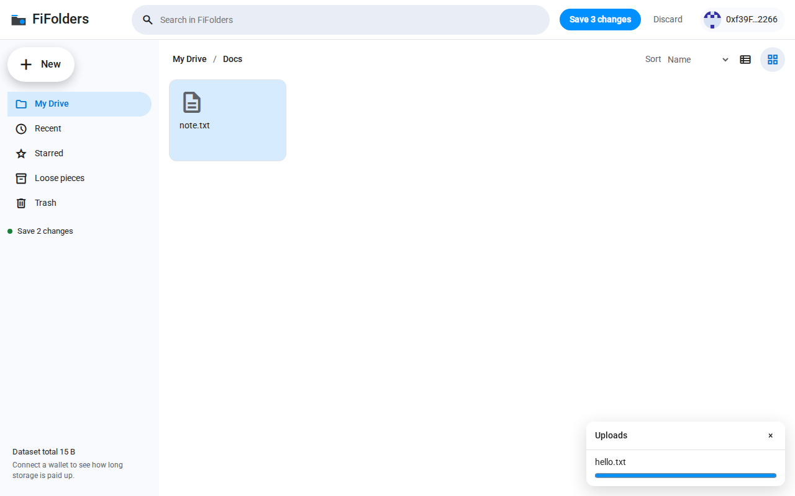
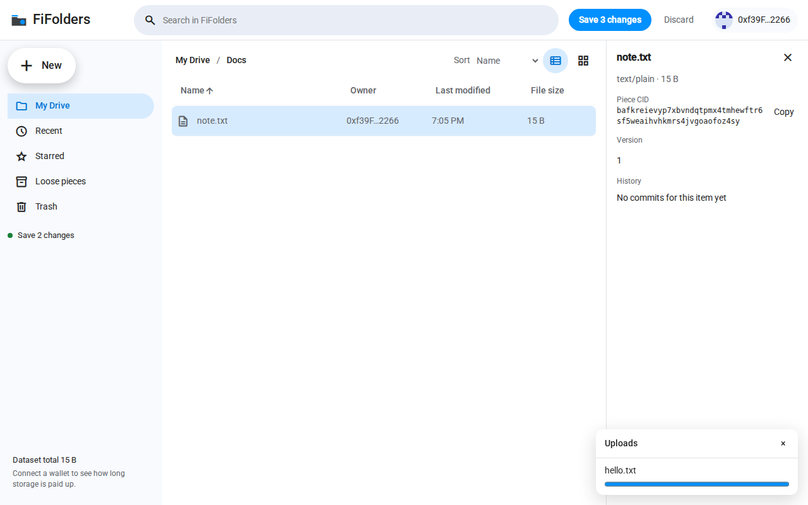

# FiFolders

A static file manager on [`fil-folders`](../../packages/fil-folders). It keeps a folder volume on Filecoin. Each save is one CAR piece (the manifest plus any new file bytes), and a Calibration `FolderRegistry` head points at that piece.

The build is plain Vite and TypeScript. `vite build` emits `dist/` with relative asset URLs, so any static host can serve it.

## Run

```bash
pnpm install
pnpm --filter fil-folders build
pnpm --filter fifolders dev
```

Connect is one button. FiFolders discovers EIP-6963 wallets and falls back to `window.ethereum`, switches or adds Calibration (or mainnet when that network is selected), and reconnects on reload with `eth_accounts` when the site is already permitted.

A browser-local secp256k1 session key is authorized once with `SessionKeyRegistry.loginAndFund` (origin `fifolders`, seven days, 0.05 FIL for gas). The permission set is Synapse's default upload permissions plus `keccak256("fil-folders.commit")`. The key is stored in `localStorage` with its expiry. Refresh in the account menu replaces it. While it is valid, dataset creation, uploads, and `FolderRegistry.commitFor` are signed locally. The authorize and deposit buttons show each phase: waiting for the signature, the transaction hash on Filfox, confirming, then authorized.

Storage payment is a separate row. If the USDFC deposit or the Warm Storage operator approval is missing, one button runs an ERC-2612 permit and `depositWithPermitAndApproveOperator` (5 USDFC).

### Wallet signatures

Connect approval (`eth_requestAccounts`) is a prompt, not a signature. Chain switch is not a signature when the wallet is already on the network.

| Visit | Signatures |
| --- | --- |
| First time, deposit and operator approval already set, encryption off | **1** (`loginAndFund`) |
| First time, payment not ready, encryption off | **3** (`loginAndFund` + permit + deposit) |
| First time, encryption on | **+1** `signTypedData`, then reused from `localStorage` |
| Returning, session key still valid | **0** |

The deployed Calibration registry `0x4893…9331` does not accept session keys. Until you deploy this build and set `VITE_FOLDER_REGISTRY` plus `VITE_REGISTRY_FROM_BLOCK`, the app falls back to the wallet for registry commits and says so. Session-key uploads still work against the live SessionKeyRegistry.

### Dataset and volume

A volume is the registry head for `(wallet, keccak256("fil-folders"), keccak256(volume name))`. A Synapse dataset is where the piece bytes live. One selected dataset serves every volume for that wallet. The choice is `fifolders:dataset:<chainId>:<address>` (last used, or the only dataset). With several datasets and no memory, Create new dataset is the primary action; the SDK picks the default provider. New datasets are tagged `{ app: "fifolders", volume: "<name>" }`. Switching the dataset in the account menu changes where new uploads go. Downloads use the piece CID. The chain record does not include byte size or a creation time; the list shows provider, piece count, and the creation date when this app stored one.

| | |
| --- | --- |
| Calibration chain id | 314159 |
| Registry | `0x4893FfF3611240fbB4Be68eFe4AA0Ec634279331` |
| Log scan start | block 4207373 |
| RPC | `https://api.calibration.node.glif.io/rpc/v1` |

Encryption is optional per volume. The choice is stored in the browser and applied the next time that volume is opened. Renames, moves, trash, and new folders stay in the browser until **Save N changes** in the top bar (Discard throws them away). A multi-file drop saves as one piece when **Auto-save uploads** is on (the default, in the account menu). Turning it off leaves uploads in that same unsaved list. The list is in `localStorage` and comes back after a refresh. Leaving the page with unsaved changes prompts first. Each Save is one activity row. Felarumi and Felanumio keep their own save and each of those is one piece. If another writer lands first, non-overlapping paths merge and a toast says so. A real path conflict names the paths and leaves the previous snapshot in place.

Trash is the `/.trash` folder. Restore uses the original path remembered in localStorage.

`.felarumi` and `.felanumio` files use their own icons and open in a new tab. The default URLs are `./felarumi/` and `./felanumio/` on this same site, so the editor and FiFolders share `localStorage` and a `BroadcastChannel` named `fifolders-ops`. A developer can override those URLs from Advanced in the account menu, or with `VITE_FELARUMI_URL` and `VITE_FELANUMIO_URL`.

New → Felarumi document opens a blank editor at `/Felarumi/<name>.felarumi` and leaves a Save pending row. New → Felanumio spreadsheet does the same under `/Felanumio`. Nothing is uploaded until the editor writes real content into the shared ops record. The row then shows Saving… and, once the piece is in the volume, Saved.

The empty templates the editors start from are:

```json
{ "v": 1, "type": "doc", "title": "Notes", "content": [{ "type": "paragraph", "text": "" }] }
```

```json
{ "v": 1, "type": "sheet", "title": "Budget", "sheets": [{ "name": "Sheet1", "cells": {} }] }
```

## Static host

```bash
pnpm --filter fifolders build
```

Serve `apps/fifolders/dist`. `base` is `./`. Pushes to `main` publish that directory to GitHub Pages for `fidrive.scionbase.ai` (`.github/workflows/pages.yml`). The workflow also checks out `snadrus/collab-edit` at the `p2p` ref (`workflow_dispatch` input `collab_ref`, or `repository_dispatch` client payload `ref`), applies `scripts/collab-edit-p2p.patch` when that branch does not already contain it, and copies the static editors to `dist/felarumi/` and `dist/felanumio/`. This token cannot push that patch to `collab-edit`; the Pages build applies it locally.

Small pieces are padded to at least 127 bytes before PDP upload and restored on read. The left bar shows the dataset total and how long the Filecoin Pay balance covers the current per-epoch rate. In-flight uploads, saves, deposits, and registry commits stay in `localStorage` under `fifolders:ops` so a refresh can show them again and drop them once the chain has the piece.

## Tests

```bash
pnpm --filter fifolders test
pnpm --filter fifolders e2e
```

Unit tests use vitest and happy-dom. The browser suite runs against an in-memory storage and registry (`VITE_E2E=1`), not a wallet. `e2e/onboarding.spec.ts` drives a mocked wallet and SessionKeyRegistry (`/?onboard=1`) and does not spend FIL or USDFC.

## Mark

The logo is an original folder shape: a dark body, a `#0090FF` tab, and a `#0090FF` disc. It is not the Filecoin logo. Icons are [Material Symbols](https://github.com/google/material-design-icons) (Apache-2.0). Text is [Roboto](https://fonts.google.com/specimen/Roboto) (OFL). `.felarumi` and `.felanumio` icons are original SVGs in `src/icons.ts`.

## Screenshots

List, with Name, Owner, Last modified, and File size:



Grid:



Details, with Piece CID, version, and history:



## License

MIT, same as the rest of this repository.
